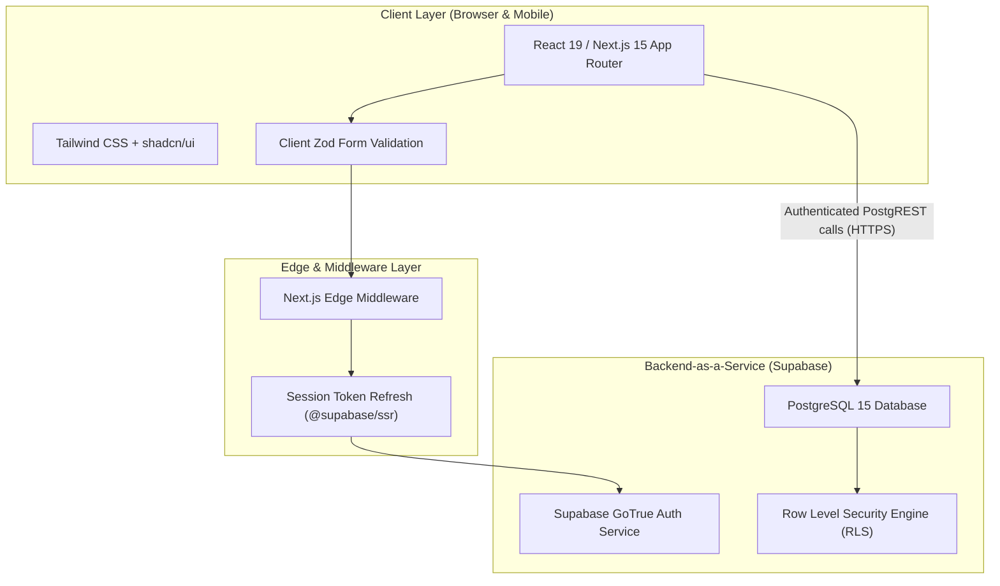

# 09. Technical Architecture: CareerFlow

> **System Overview:** Modern Full-Stack Jamstack Architecture built for high reliability, fast edge delivery, and complete tenant isolation.

---

## 1. High-Level Architecture Diagram

---

## 2. Core Architectural Pillars

### A. Strict Tenant Isolation (Zero Data Leakage)
- Multi-tenancy is enforced directly inside PostgreSQL via Row Level Security (RLS).
- Table `public.applications` assigns foreign key `user_id REFERENCES auth.users(id) ON DELETE CASCADE`.
- Four distinct RLS policies guard SELECT, INSERT, UPDATE, and DELETE operations using `auth.uid() = user_id`.
- Even if a client bypasses UI checks, PostgreSQL refuses to return or mutate any record belonging to another user.

### B. Graceful Degradation & Honest Configuration Handling
- `src/lib/supabase/status.ts` inspects environment variables before performing network requests.
- When `NEXT_PUBLIC_SUPABASE_URL` is unconfigured or dummy, CareerFlow:
  1. Does **not** throw cryptic runtime crashes or unhandled promise rejections.
  2. Does **not** inject deceptive mock data pretending to be live saved records.
  3. Displays an actionable, high-visibility setup card instructing the developer how to provide their `.env.local` keys.

### C. Type Safety Across Layers
- Single source of truth for Application Status: TypeScript union `ApplicationStatus` matches Postgres ENUM `application_status` and Zod `applicationStatusEnum`.
- Forms strictly validate types and constraints before triggering Supabase mutations.

### D. Date Indexing & Deadline Computation
- The database schema introduces partial B-Tree indices:
  - `idx_applications_assessment_date` WHERE `assessment_date IS NOT NULL`
  - `idx_applications_interview_date` WHERE `interview_date IS NOT NULL`
  - `idx_applications_follow_up_date` WHERE `follow_up_date IS NOT NULL`
- This ensures $O(\log n)$ deadline sorting even when candidate volume scales.
